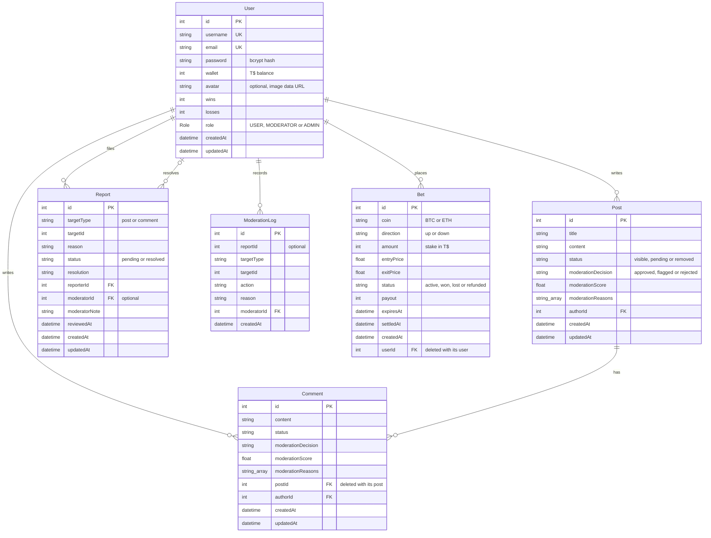

*This project has been created as part of the 42 curriculum by mcarepa-, &lt;hugo-login&gt;, &lt;pedro-login&gt;, &lt;rafael-login&gt;, &lt;duarte-login&gt;.*

<!-- TODO(team): replace the four placeholders above with the 42 logins. -->

# Transcendence

## Description

**Transcendence** is a real-time crypto price prediction game with a community
forum. Players bet a virtual currency (**T$**) on whether the price of **Bitcoin**
or **Ethereum** will go **up** or **down** in the next 60 seconds. Prices come
live from the Kraken exchange, and the server records the prices and settles
every bet. A forum lets players discuss, with automatic and manual moderation.

The goal of the project, the last one of the 42 Common Core, is to build a
complete web application as a team: frontend, backend and database, secure by
default, deployed with a single command, and observable in production.

### Key features

- **Accounts**: registration with username, email and password, login with
  the username or the email and the password (JWT sessions, bcrypt-hashed
  passwords), profile with avatar, password change, and roles (user,
  moderator, administrator). Every form is validated in the browser and again
  by the server.
- **Live prices**: BTC and ETH prices from the Kraken WebSocket API, pushed to
  every open browser in real time with Socket.IO, on a candlestick chart like
  TradingView's (1 m, 5 m, 15 m and 1 h candles, zoom with the mouse wheel or a
  pinch, drag to move). Each running bet of the player is drawn on the chart
  at its entry price: a green line for UP, a red line for DOWN.
- **Server-side betting engine**: only logged-in players can bet, and only
  whole positive amounts. The server checks every bet, keeps the balance and
  the bets in the database, settles each 60-second bet with the live price and
  pays it; the page only shows the result, which arrives in real time. Safe
  when many users bet at the same time.
- **Forum**: posts and comments, search with filters, sorting and pagination,
  reports, rule-based automatic moderation and a moderation page.
- **Administration**: user list and role management in the application, and a
  public admin API protected by an API key, with rate limiting and Swagger
  documentation.
- **Security**: HTTPS only, ModSecurity web application firewall (OWASP CRS),
  secrets in HashiCorp Vault, validation of every input, rate limiting.
- **Operations**: centralised logs (Elasticsearch, Logstash, Kibana, Filebeat),
  monitoring and alerts (Prometheus, Grafana), health checks, a status page and
  daily database backups.
- **Analytics dashboard**: charts of each player's results (profit, win rate,
  results by coin and direction), filters by period, coin and direction, live
  updates, and CSV, JSON and PDF export.
- **Legal pages**: Privacy Policy and Terms of Service, linked from the footer.

## Instructions

### Prerequisites

- Linux with **Docker Engine** and the **Docker Compose v2** plugin (`docker compose`)
- **GNU make**, **openssl** and **git**
- Ports **80** and **443** free on the machine
- Internet access (Docker images, npm packages and the live prices)
- The latest stable **Google Chrome**

### 1. Configure the environment

```bash
git clone <repository-url> transcendence
cd transcendence
cp .env.example .env
```

Then edit `.env` and replace every placeholder (`change_me…`, `your_…`,
`<openssl …>`, `ADMIN_API_KEY_VALUE`) with your own value. Every value must be
written without spaces; random values can be generated with
`openssl rand -hex 32`. `.env` is ignored by git.

| Variable | Used for |
|----------|----------|
| `POSTGRES_USER`, `POSTGRES_PASSWORD`, `POSTGRES_DB` | PostgreSQL database |
| `REDIS_PASSWORD` | Redis (rate limiting) |
| `JWT_SECRET` | signing the login tokens |
| `ADMIN_USERNAME`, `ADMIN_EMAIL`, `ADMIN_PASSWORD` | administrator account created at the first start |
| `ADMIN_API_KEY` | key of the public admin API (`X-API-Key` header) |
| `GF_SECURITY_ADMIN_USER`, `GF_SECURITY_ADMIN_PASSWORD` | Grafana login |
| `ELASTIC_PASSWORD` | Elasticsearch superuser `elastic` (also the Kibana login) |
| `KIBANA_PASSWORD` | internal `kibana_system` user |
| `XPACK_ENCRYPTEDSAVEDOBJECTS_ENCRYPTIONKEY` | Kibana encryption key, **at least 32 characters** |
| `VAULT_ADDR`, `VAULT_CACERT`, `BACKEND` | internal addresses, keep the defaults |

The secrets are loaded into HashiCorp Vault at startup; the backend reads them
from Vault, not from `.env`.

### 2. Start

```bash
make
```

This creates the TLS certificates (`scripts/setup-certs.sh`), builds the images,
starts every container and waits until they are healthy. Then open
**https://localhost** and accept the self-signed certificate. Log in with
`ADMIN_USERNAME` / `ADMIN_PASSWORD` from `.env`, or create an account.

### Useful commands

| Command | What it does |
|---------|--------------|
| `make` | create the certificates, build and start everything |
| `make down` | stop the containers (data is kept) |
| `make ps` | list the containers and their state |
| `make logs` / `make logs SERVICE=backend` | follow the logs |
| `make exec SERVICE=postgres` | open a shell in a container |
| `make update` | rebuild and restart after a code change, keeping the data |
| `make fclean` | remove this project's containers, volumes, images, certificates and backups |
| `make re` | `make fclean` then `make` |

After a reboot of the machine, run `make down` and then `make`: Vault starts
sealed, and this unseals it before the backend starts.

### Other addresses

| Address | What |
|---------|------|
| https://localhost/grafana/ | Grafana dashboards (Grafana login from `.env`) |
| https://localhost/kibana/ | Kibana logs (user `elastic`, `ELASTIC_PASSWORD`) |
| https://localhost/prometheus/ | Prometheus |
| https://localhost/status | status page |
| https://localhost/health | backend health check (JSON) |
| https://localhost/api/admin/docs | Swagger documentation of the public admin API |

### Tests

- `bash scripts/test-public-api.sh`: tests the public admin API (asks for the API key).
- `bash scripts/test-bets.sh`: tests the betting engine end to end (about 75 seconds).
- `bash scripts/test-analytics.sh`: tests the analytics endpoint and the real-time socket (about 10 seconds).
- `bash scripts/test-users.sh`: tests the account rules: usernames, login with the email, and avatars (about 10 seconds).
- `bash scripts/test-forum.sh`: tests that ordinary sentences pass the WAF in the forum while attacks are still refused, and the date filter (about 5 seconds).

nginx allows 10 logins a minute per address, so leave a minute between two
runs of these scripts.

## Team Information

<!-- TODO(team): confirm the roles below; they were never written down in the repository. -->

| Member | GitHub | Role(s) | Responsibilities |
|--------|--------|---------|------------------|
| Hugo Dias | `hugo-mar` | Project Manager, Developer | Planning and task distribution; forum, moderation and public admin API |
| Rafael Matos | `1Fr3aK2` | Technical Lead / Architect, Developer | Docker architecture, security (TLS, WAF, Vault), DevOps (ELK, Prometheus, Grafana, backups); reviews and merges pull requests |
| Pedro Silva | `SuVao` | Developer (backend) | NestJS backend, authentication, users and roles, Kraken price feed |
| Duarte Araujo | `dsteiger42` | Product Owner, Developer (frontend) | Product vision and priorities; React interface |
| Miguel Dias | `mcarepa-42` | Developer | Server-side betting engine and its connection to the betting screen, analytics dashboard, project audit and fixes, legal pages, README |

## Project Management

- **Organisation**: the idea and the division of work were decided in meetings
  at school (the first one on 9 June). Each member owns one area: frontend,
  backend core, betting engine, forum and moderation, infrastructure and
  security.
- **Workflow**: one branch per feature or member, pull requests into `dev`,
  reviewed by another member before merging. Changes that touch another
  member's area are announced to that member first and listed in the pull
  request description.
- **Tools**: GitHub (repository, branches, pull requests and reviews) and
  documentation kept in the repository (`docs/` and a README in each backend
  module).
- **Communication**: a team group chat for daily coordination, and regular
  meetings at school.

<!-- TODO(team): add any task board used (GitHub Issues, Trello...) and name the chat tool. -->

## Technical Stack

| Layer | Technologies |
|-------|--------------|
| Frontend | React 18, Vite 5, Socket.IO client, TradingView Lightweight Charts (candlestick chart), Recharts (analytics charts), hand-written CSS in two stylesheets (`style.css` and `responsive.css`) |
| Backend | NestJS 10 (TypeScript, Node.js 20), Prisma 6, Passport JWT, bcrypt, class-validator, Socket.IO, Swagger (OpenAPI), prom-client |
| Database | PostgreSQL 16 (application data), Redis (rate-limit counters) |
| Reverse proxy and security | nginx with ModSecurity and the OWASP Core Rule Set 4, HashiCorp Vault |
| Logs | Elasticsearch, Logstash, Kibana 8.19, Filebeat |
| Monitoring | Prometheus, Grafana, nginx / PostgreSQL / Redis exporters |
| Deployment | Docker Compose, GNU make |
| External APIs | Kraken WebSocket API v2 (live prices), Kraken REST API (candles), CoinGecko (price history) |

Why these choices:

- **React** gives a component model the frontend developer already knew, and
  Vite builds and reloads it quickly.
- **NestJS** gives the backend a clear structure (modules, controllers,
  services), and built-in guards, validation pipes and WebSocket gateways, all
  in TypeScript.
- **PostgreSQL** fits relational data with clear links (users, posts,
  comments, reports, bets), and its transactions and row locks make the balance
  safe under concurrent bets.
- **Prisma** gives typed queries and simple migrations; the team chose it over
  TypeORM because its migrations are easier to manage with NestJS.
- **Docker Compose** runs the whole platform (about twenty containers) with
  one command, the same way on every machine.
- **Styling**: plain CSS, written by hand, in two stylesheets: `style.css` says
  how every component looks, and `responsive.css` only adapts the layout to
  phones and tablets. The team chose this over a CSS framework to keep one
  consistent dark theme without extra dependencies; Vite bundles both files
  into one at build time.
- **TradingView Lightweight Charts** draws the candlestick chart: it is the
  open-source library behind TradingView's charts (zoom, scrolling, price
  lines), small and fast because it draws on a canvas.

## Database Schema



- **User** is at the centre: it writes posts and comments, files reports,
  resolves them when it is a moderator, and places bets. `username` and `email`
  are unique; the password is only stored as a bcrypt hash.
- **Post → Comment**: a post has many comments, deleted with the post.
- **Report** points to the reported post or comment with `targetType` and
  `targetId`; `moderatorId` stays empty until a moderator resolves it.
- **ModerationLog** keeps the history of every moderation action.
- **Bet** belongs to one user. Its `status` goes from `active` to `won`, `lost`
  or `refunded` when the server settles it.

The schema is in `backend/prisma/schema.prisma` and every change is a migration
in `backend/prisma/migrations/`, applied automatically at startup.

## Features List

<!-- TODO(team): check the names; they come from the authors of the commits in each folder. -->

| Feature | Description | Member(s) |
|---------|-------------|-----------|
| Registration and login | Registration with username, email and password; login with the username or the email (JWT); usernames of 3 to 20 letters, digits, `_`, `.` or `-`; brute-force protection (5 failed attempts per 30 minutes) | Pedro (backend), Duarte (frontend), Miguel (login with the email, username rules) |
| Profile and settings | Change username, avatar and password; pictures of up to 10 MB are shrunk to 256 x 256 in the browser before being sent | Pedro, Duarte, Miguel (avatar checks) |
| Roles and administration | Roles user / moderator / administrator; admin page to list users and change roles | Pedro, Duarte |
| Live prices | BTC and ETH from the Kraken WebSocket API, broadcast to every browser with Socket.IO | Pedro (backend), Duarte (frontend) |
| Candlestick chart | TradingView-style chart: candles from Kraken (`GET /crypto/:coin/candles`), 1 m to 1 h candles, zoom and scrolling, live last candle, and a green (UP) or red (DOWN) line at the entry price of each running bet | Miguel |
| Betting engine | Only logged-in players can bet, and only whole positive amounts; balance and bets in the database; 60-second bets settled by the server with live prices; atomic balance updates; results and balance pushed to the page in real time; history | Miguel (backend and its connection to the betting screen), Duarte (betting screen) |
| Analytics dashboard | Cumulative profit, profit by day, results, and win rate by coin and direction; filters by period, coin and direction; live updates through a per-user socket; CSV, JSON and PDF export | Miguel |
| Forum | Posts, comments, editing and deleting your own content, search with filters, sorting and pagination | Hugo (backend), Duarte (frontend) |
| Moderation | Reports, rule-based automatic moderation (scam, spam and abuse patterns), moderators' review of reports and held content, moderation log | Hugo (backend), Duarte (frontend) |
| Public admin API | 8 endpoints (users, roles, reports, moderation, posts) with an API key, rate limiting (nginx and Redis) and Swagger documentation | Hugo, Rafael |
| HTTPS and reverse proxy | nginx with TLS, HTTP to HTTPS redirection, WebSocket proxying, rate limits | Rafael |
| Web application firewall | ModSecurity with the OWASP CRS at paranoia level 2, with exclusions limited to specific fields | Rafael, Miguel |
| Secrets management | HashiCorp Vault in server mode with TLS and AppRole; the backend reads its secrets from Vault | Rafael |
| Logs | Elasticsearch, Logstash, Kibana and Filebeat; logs deleted after 14 days, daily snapshots kept 30 days | Rafael, Miguel |
| Monitoring | Prometheus, exporters, Grafana dashboard, alert rules | Rafael, Miguel |
| Health and backups | Health checks, status page, daily PostgreSQL backups kept 7 days, disaster recovery procedure | Rafael |
| Legal pages | Privacy Policy and Terms of Service written for the application, linked from the footer | Miguel |
| Responsive layout and accessibility | Every page works on phones (390 px) and tablets; labelled form fields; no errors or warnings in the browser console | Duarte (design), Miguel (phone and tablet rules, labels) |

## Modules

<!-- TODO(team): confirm this list together before the evaluation. Only modules that work completely are listed. -->

| # | Module | Category | Type | Points | Member(s) |
|---|--------|----------|------|--------|-----------|
| 1 | Use a framework for both the frontend and the backend | Web | Major | 2 | Duarte, Pedro, Hugo, Miguel |
| 2 | Real-time features using WebSockets | Web | Major | 2 | Pedro, Duarte, Miguel |
| 3 | Public API with an API key, rate limiting and documentation | Web | Major | 2 | Hugo, Rafael |
| 4 | WAF / ModSecurity (hardened) and HashiCorp Vault | Cybersecurity | Major | 2 | Rafael, Miguel |
| 5 | Log management with ELK | Devops | Major | 2 | Rafael, Miguel |
| 6 | Monitoring with Prometheus and Grafana | Devops | Major | 2 | Rafael, Miguel |
| 7 | Use an ORM for the database | Web | Minor | 1 | Pedro, Hugo, Miguel |
| 8 | Advanced search with filters, sorting and pagination | Web | Minor | 1 | Hugo, Duarte |
| 9 | Health check and status page, automated backups and disaster recovery | Devops | Minor | 1 | Rafael |
| 10 | Advanced analytics dashboard with data visualization | Data and Analytics | Major | 2 | Miguel |
| | **Total** | | | **17** | |

The minimum is 14 points; the 3 extra points count as bonus (at most 5). Not claimed because
they are not complete: user interaction (needs chat and friends), standard user
management (needs friends and online status), advanced permissions (the team
decided not to add user deletion), languages, additional browsers, and content
moderation AI (our moderation is rule-based, not AI).

### Why we chose each module and how it is implemented

1. **Frameworks (React + NestJS)**: both give a structure the whole team can
   follow. The frontend is a React application (`frontend/`); the backend is a
   NestJS application split into modules (`backend/src/`: auth, users, crypto,
   bets, analytics, forum, moderation, public-api, health, metrics, vault).
2. **Real-time WebSockets**: prices are the heart of the game. `KrakenService`
   keeps a WebSocket connection to Kraken (reconnecting after 5 seconds if it
   drops) and emits every ticker; `CryptoGateway` broadcasts it to all browsers
   with one Socket.IO event, and the Socket.IO client reconnects by itself. A
   second namespace, `/bets`, checks the login token and tells each user, in a
   room of their own, when one of their bets is placed or settled.
3. **Public API**: lets administrators and scripts manage users, reports and
   posts without the interface. `backend/src/public-api` exposes 8 endpoints
   under `/api/admin` (GET, POST, PUT, PATCH and DELETE), checks the
   `X-API-Key` header, limits requests in nginx and in Redis, and documents
   everything with Swagger at `/api/admin/docs`. `scripts/test-public-api.sh`
   tests it.
4. **WAF and Vault**: every request goes through ModSecurity with the OWASP
   CRS at paranoia level 2; the few exclusions (avatar upload, PromQL queries
   of Grafana and Prometheus) only cover the exact fields that need them.
   Vault runs in server mode with TLS; `vault_init` initialises and unseals it,
   stores the secrets and gives the backend an AppRole with a read-only policy.
5. **ELK**: Filebeat collects the container logs and the ModSecurity audit log,
   Logstash parses them, Elasticsearch stores them with an ILM policy (deleted
   after 14 days, daily snapshots kept 30 days) and Kibana shows them behind a
   login. Logstash writes with a dedicated user that only has the permissions
   it needs.
6. **Prometheus and Grafana**: Prometheus scrapes the backend (requests and
   latency per route) and the nginx, PostgreSQL and Redis exporters, with alert
   rules for each service being down. Grafana, behind a login, shows the
   provisioned dashboard.
7. **ORM**: Prisma describes the schema, generates typed queries and versions
   every change as a migration applied at startup.
8. **Advanced search**: the forum search combines text, author and date
   filters, sorting by date or title, and pagination.
9. **Health, status page and backups**: `/health` checks the database, Redis,
   Vault and Elasticsearch; `/status` shows it as a page; a container dumps PostgreSQL every
   day and keeps 7 days; `docs/backup-scripts/Disaster-Recovery.md` explains how
   to restore.
10. **Analytics dashboard**: a trading game lives on its results, and the
    subject suggests this module for a trading simulator.
    `GET /users/me/analytics` (`backend/src/analytics`) computes the figures for
    the chosen period, coin and direction. The page at `#/analytics` (Analytics
    button in the navbar) draws 4 Recharts charts with tooltips and data
    tables, reloads when the `/bets` socket says a bet changed, and exports
    CSV, JSON and a PDF report written without a PDF library.
    `scripts/test-analytics.sh` tests it.

## Individual Contributions

<!-- TODO(team): each member should check and complete their own entry, especially the challenges. -->

### Hugo Dias

- Forum module: posts, comments, search with filters, sorting and pagination.
- Moderation: reports, rule-based automatic moderation, manual review and moderation log.
- Public admin API with API key, rate limiting and Swagger documentation; its test script.
- Prisma schema and migrations for the forum and the roles; code reviews.
- Challenges: <!-- TODO(Hugo) -->

### Rafael Matos

- Docker Compose architecture and the Makefile.
- nginx reverse proxy with TLS, rate limits and WebSocket support; ModSecurity WAF hardening.
- HashiCorp Vault in server mode with AppRole, and loading the secrets into the backend.
- ELK stack, Prometheus, Grafana, exporters and alert rules; health checks, status page, backups and disaster recovery; security documentation in `docs/`.
- Reviews and merges of the pull requests.
- Challenges: <!-- TODO(Rafael) -->

### Pedro Silva

- NestJS backend base; authentication with JWT; users, profile, password and roles.
- Live price feed from Kraken over WebSocket, broadcast with Socket.IO; price history from CoinGecko.
- Challenges: <!-- TODO(Pedro) -->

### Duarte Araujo

- React frontend: trading screen (coin selector, price display, chart, bet panel, active bets and history), login and registration, settings, forum, moderation and admin pages; integration with the backend API and Socket.IO.
- Challenges: <!-- TODO(Duarte) -->

### Miguel Dias

- **Betting engine** (`backend/src/bets`): balance, placing bets, history, and the settlement loop; new accounts start with 1000 T$ set by the server; `Bet` table and migration; `scripts/test-bets.sh`.
- **Analytics dashboard** (module Data and Analytics, Major): `GET /users/me/analytics`, the `/bets` real-time socket, and the dashboard page with 4 charts, filters, live updates and CSV, JSON and PDF export; `scripts/test-analytics.sh`.
- **Project audit** against the subject, and fixes for the problems that would have failed the evaluation: Filebeat not starting on hosts with umask 002, Kibana not starting with the `.env.example` values, and Grafana panels and Prometheus queries blocked by the WAF.
- **Privacy Policy and Terms of Service** pages and the footer.
- **Candlestick chart** like TradingView's, with TradingView Lightweight Charts: candles from Kraken through `GET /crypto/:coin/candles` (`backend/src/candles`), zoom, candle sizes, and a green or red line at the entry price of each running bet.
- **Final version**: connected the betting screen to the server (login required, whole positive amounts only, results in real time, live 24 h price statistics), login with the email, username and avatar checks in the browser and the server, phone and tablet layout, form labels, favicon and a clean browser console; `scripts/test-users.sh`.
- **This README**.
- Challenges:
  - My first pull request bundled too many changes across other members' areas and had to be reverted. I then split my work into small, focused pull requests and announced every change outside my area.
  - Two users betting at the same time could overdraw a balance if it was read first and written later. The stake is now debited with one conditional `UPDATE ... WHERE wallet >= amount`, which PostgreSQL runs atomically.
  - PromQL operators looked like SQL injection to the WAF. Instead of switching rules off everywhere, the exclusion only covers the query fields of the two read-only monitoring endpoints.
  - The WAF refused 40 of 91 ordinary forum texts, such as "Find the best strategy" or "Top 3 tips": sentences starting with a word that is also a Unix command read like command injection. The command and SQL injection rules no longer inspect the forum's text fields (the backend runs no shell and Prisma sends text as parameters), while the XSS rules still do; afterwards, 0 of 91 were refused and the attack payloads still were.
  - One avatar in five was refused by the WAF, because random base64 text looks like SQL to it. Sending hundreds of random pictures showed that the SQL rules, and rarely the XSS ones, were involved, so the SQL, XSS and command-injection rules no longer inspect the avatar field alone, and the server now accepts nothing but an image in that field (300 random pictures out of 300 pass).

## Resources

### Documentation

- NestJS: https://docs.nestjs.com (modules, guards, validation pipes, WebSocket gateways)
- Prisma: https://www.prisma.io/docs (schema, migrations, transactions)
- React: https://react.dev; Vite: https://vite.dev/guide
- Socket.IO: https://socket.io/docs/v4
- Recharts: https://recharts.org
- TradingView Lightweight Charts: https://tradingview.github.io/lightweight-charts/ (see Credits below)
- Kraken REST API, OHLC data: https://docs.kraken.com/api/docs/rest-api/get-ohlc-data
- Kraken WebSocket API v2: https://docs.kraken.com/api/docs/websocket-v2/ticker
- CoinGecko API: https://docs.coingecko.com
- PostgreSQL: https://www.postgresql.org/docs/16/
- ModSecurity and the OWASP Core Rule Set: https://coreruleset.org/docs
- HashiCorp Vault (AppRole): https://developer.hashicorp.com/vault/docs/auth/approle
- Elastic Stack and ILM: https://www.elastic.co/guide
- Prometheus: https://prometheus.io/docs; Grafana: https://grafana.com/docs
- Docker Compose: https://docs.docker.com/compose/
- OWASP Cheat Sheet Series (authentication, password storage): https://cheatsheetseries.owasp.org
- GDPR: https://gdpr.eu; Portuguese data protection authority: https://www.cnpd.pt

### Use of AI

<!-- TODO(team): each member adds how they used AI tools for their part. -->

- **Planning**: after the first meeting, ChatGPT was used to turn the agreed idea
  into a first plan and division of work, which the team then discussed and
  adjusted.
- **Miguel** used Claude (Anthropic) through Claude Code to audit the project
  against the subject, to write and test the betting engine and its test
  script, to find and fix the ELK, `.env` and WAF problems, to connect the
  betting screen to the server and make the layout work on phones, to build
  the candlestick chart, and to draft the legal pages and this README. Every change was reviewed, run and tested on
  the real stack, and Miguel can explain and modify it.

## Known limitations

- Only BTC and ETH can be bet on: they are the coins of the live Kraken feed.
- A bet is settled with the last price received from Kraken; if the server
  cannot settle it within 10 seconds of its end (for example during a
  restart), the stake is refunded.
- The application is tested on the latest stable Google Chrome only.
- Prometheus is reachable through nginx without a login (read-only); Grafana
  and Kibana require one.
- Filebeat reads the logs of every Docker container on the host, not only this
  project's.
- The certificates are self-signed, so the browser shows a warning the first time.
- After a reboot, run `make down` and then `make`, so that Vault is unsealed
  before the backend starts.

<!-- TODO(team): update this list before the evaluation (frontend production build). -->

## Credits

- Candlestick chart: **TradingView Lightweight Charts™**, Copyright (c) 2025
  TradingView, Inc., https://www.tradingview.com/, used under the Apache
  License 2.0. The TradingView logo on the chart links to their website, as the
  license asks.
- Prices: Kraken (live prices and candles) and CoinGecko (price history).
